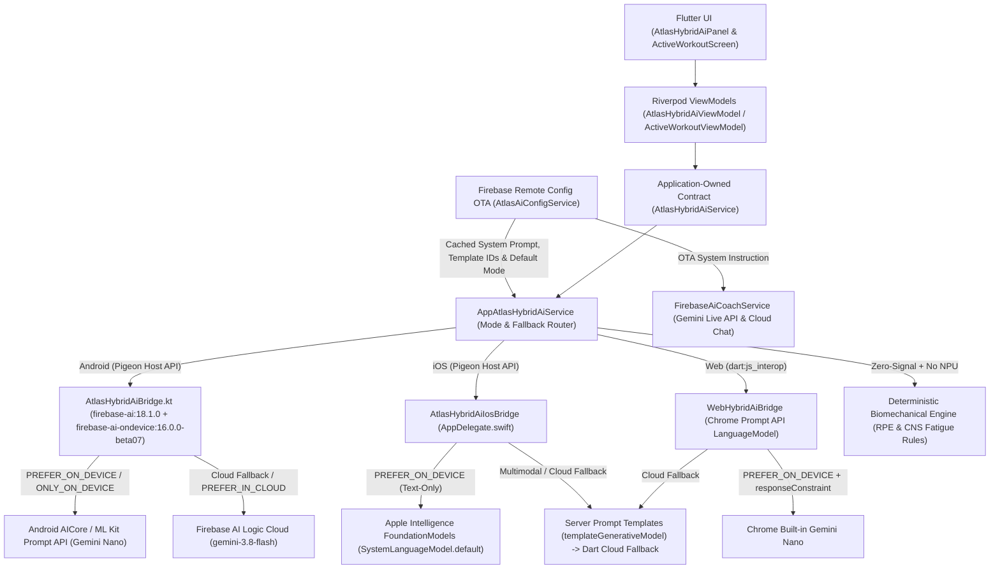

# CommunityFitness — ATLAS Hybrid AI (`#BuildHybridAI 2026`)

**CommunityFitness (ATLAS)** is a hybrid on-device + cloud AI strength training coach built with **Firebase AI Logic**, **Flutter**, and **60 FPS 3D Rive anatomical animations**. It solves the real-world "Basement Gym Problem": strength athletes train in concrete basements with dead cellular zones, require instant (<30 ms) between-set load autoregulation at zero token cost, and want private equipment/posture image checks that never leave their device—while seamlessly escalating to **Cloud Gemini (`gemini-3.8-flash`)**, **Dotprompt Server Prompt Templates (`templateGenerativeModel`)**, and **Gemini Live API** when online or on unsupported hardware.

---

## Quick Verification Path (For Judges)

1. **Run the Hybrid AI Test Suite (Unit & Widget Tests)**:
   ```bash
   flutter test test/services/atlas_hybrid_ai_service_test.dart \
                test/views/atlas_hybrid_ai_panel_test.dart \
                test/views/active_workout_hybrid_test.dart
   ```
2. **Test Live Hybrid Inference, OTA Prompt Governance & Telemetry in the App**:
   - **Inside ATLAS AI Coach**: Tap the 3D Gyro-Core avatar in the header, then tap the **`Hybrid NPU`** chip (`ai_coach_hybrid_mode_button`). Switch live between `Prefer On-Device`, `Only On-Device`, `Prefer Cloud`, and `Only Cloud`, toggle **`Dotprompt · atlas-set-autoregulation-v1-0-0`** (`hybrid_server_template_toggle`), log a set, or run a 1-tap **Private Equipment Scan (1-Image)**.
   - **Inside Active Workout**: Start any workout and tap **`RPE 7 · +2.5kg`**, **`RPE 8.5 · Keep`**, or **`RPE 9.5 · -5% Load`** on any exercise step card to see instant load/rest autoregulation and the live telemetry banner (`ON-DEVICE · Gemini Nano`, `ON-DEVICE · Apple Intelligence`, `ON-DEVICE · Chrome Gemini Nano`, `IN-CLOUD · gemini-3.8-flash`, or `OFFLINE ENGINE`).

---

## 5-Pillar ADS26 Hybrid AI Architecture

Following the Android Dev Summit 2026 reference architecture (*"Build optimized Android Apps with Firebase AI Logic and Gemini Nano 4"*), ATLAS combines 5 complementary layers:

1. **Cross-Platform On-Device NPU Inference**:
   - **Android**: `com.google.firebase:firebase-ai:18.1.0` + `com.google.firebase:firebase-ai-ondevice:16.0.0-beta07` via Android AICore (`Gemini Nano`).
   - **iOS**: Apple Intelligence `FoundationModels` (`SystemLanguageModel.default` & `LanguageModelSession` on iOS 26+).
   - **Web**: Chrome Built-in AI Prompt API (`LanguageModel.availability()`, `create()`, `prompt()` with JSON `responseConstraint`).
2. **Dynamic 4-Mode Hybrid Router (`HybridInferenceMode`)**:
   - Supports `PREFER_ON_DEVICE`, `ONLY_ON_DEVICE`, `PREFER_IN_CLOUD`, and `ONLY_IN_CLOUD` with automatic telemetry (`ON-DEVICE`, `IN-CLOUD`, `OFFLINE ENGINE`) and latency tracking (`ms`).
3. **Firebase Remote Config OTA Governance (`AtlasAiConfigService`)**:
   - Updates `atlas_coach_system_prompt`, `atlas_hybrid_set_prompt_template`, `atlas_cloud_model_name`, `atlas_default_hybrid_mode`, and active Dotprompt template IDs over-the-air (`firebase/remote_config_defaults.json`) with offline-first local caching.
4. **Dotprompt Server Prompt Templates (`templateGenerativeModel`)**:
   - Executes versioned server-side templates (`firebase/prompt_templates/atlas-set-autoregulation-v1-0-0.prompt` & `atlas-coach-chat-v1-0-0.prompt`) via `FirebaseAI.googleAI().templateGenerativeModel().generateContent(templateId, inputs: ...)` with transparent fallback to Remote Config prompts when offline or unprovisioned.
5. **Deterministic Biomechanical Offline Engine**:
   - Guarantees 100% availability in zero-signal basement gyms even on legacy devices without an NPU.



---

## Dual Prompt Governance: Why Remote Config + Server Prompt Templates Work Together

A key architectural insight from official Firebase AI Logic documentation is that **Server Prompt Templates** and **Firebase Remote Config** solve different parts of the hybrid stack:

| Execution Engine | Can Use `templateGenerativeModel`? | How ATLAS Governs Prompts & Models OTA |
| :--- | :--- | :--- |
| **On-Device NPU** (Android AICore / iOS `FoundationModels` / Chrome `LanguageModel`) | **No** — On-device inference runs entirely offline on local hardware without a Firebase server round-trip. | **Remote Config OTA (`AtlasAiConfigService`)** caches `atlas_hybrid_set_prompt_template` (`{{rawSetText}}`, `{{catalogContext}}`) and `atlas_coach_system_prompt` on the device so local NPU prompts can be tuned over-the-air and still work in airplane mode. |
| **Gemini Live API** (`BidiGenerateContent` real-time voice) | **No** — Live WebSocket audio sessions require `liveGenerativeModel(systemInstruction: ...)`. | **Remote Config OTA (`AtlasAiConfigService`)** injects `atlas_coach_system_prompt` and `atlas_live_model_name` into `FirebaseAiCoachService`. |
| **Cloud Gemini Inference** (`PREFER_IN_CLOUD`, `ONLY_IN_CLOUD`, or NPU fallback) | **Yes** (`templateGenerativeModel`) | **Server Prompt Templates + Remote Config Versioning**: Remote Config supplies the active `atlas_set_autoregulation_template_id` (`atlas-set-autoregulation-v1-0-0`), keeping prompt logic and schema validation on the server while falling back transparently if unprovisioned. |

---

## Key Implementation Files

| Layer | File | Responsibility |
| :--- | :--- | :--- |
| **Pigeon Schema** | `pigeons/atlas_hybrid_ai_api.dart` | Strongly-typed contract for the 4 inference modes, model lifecycle (`checkStatus`, `download`, `warmUp`), multimodal bytes, and `inferenceSource` telemetry. |
| **Android Bridge** | `android/app/src/main/kotlin/com/comunityfitness/comunityfitness/AtlasHybridAiBridge.kt` | Official `com.google.firebase:firebase-ai:18.1.0` + `firebase-ai-ondevice:16.0.0-beta07` integration with `OnDeviceConfig`, `Bitmap` decoding, and `inferenceSource` inspection. |
| **iOS Bridge** | `ios/Runner/AppDelegate.swift` (`AtlasHybridAiIosBridge`) | Apple Intelligence `FoundationModels` (`SystemLanguageModel.default` & `LanguageModelSession`) on-device execution with automatic delegation to Dart Cloud for multimodal/fallback requests. |
| **Web Bridge** | `lib/services/web_hybrid_ai_bridge_web.dart` | `dart:js_interop` integration with Chrome's `LanguageModel` Prompt API (`availability()`, `create()`, and `prompt()` with JSON `responseConstraint`). |
| **OTA Config & Templates** | `lib/services/atlas_ai_config_service.dart`, `firebase/remote_config_defaults.json`, `firebase/prompt_templates/*.prompt` | Application-owned `AtlasAiConfigService` contract, Remote Config parameter defaults, and Dotprompt server templates (`atlas-set-autoregulation-v1-0-0`, `atlas-coach-chat-v1-0-0`). |
| **Domain Service** | `lib/services/atlas_hybrid_ai_service.dart` | Zero-SDK-leak `AtlasHybridAiService` contract (`flutter-sdk-contracts`), `AppAtlasHybridAiService` router, `templateGenerativeModel` execution + fallback, and `FakeAtlasHybridAiService`. |
| **Hybrid UI & Active Workout** | `lib/views/widgets/atlas_hybrid_ai_panel.dart` & `lib/views/active_workout_screen.dart` | Interactive 4-mode switcher, `hybrid_server_template_toggle` Dotprompt chip, live platform-aware telemetry badges, 1-image scanner, and 1-tap RPE set autoregulation chips. |

---

## Verification Checklist

- [x] **Firebase AI Logic Hybrid Modes**: Supports `PREFER_ON_DEVICE`, `ONLY_ON_DEVICE`, `PREFER_IN_CLOUD`, and `ONLY_IN_CLOUD`.
- [x] **Cross-Platform On-Device Engines**: Android (`firebase-ai-ondevice` / AICore), iOS (`FoundationModels` / Apple Intelligence), and Web (Chrome Prompt API `LanguageModel`).
- [x] **Dual OTA Governance**: Firebase Remote Config (`AtlasAiConfigService`) + Dotprompt Server Prompt Templates (`templateGenerativeModel`) with transparent fallback.
- [x] **Real-Time Telemetry**: Every response displays its actual execution source (`ON-DEVICE`, `IN-CLOUD`, or `OFFLINE ENGINE`), model/template identifier, and latency in `ms`.
- [x] **Security & Attestation**: Enforces Firebase App Check and Firebase Authentication on all cloud calls.
- [x] **Automated Test Coverage**: Unit and widget test suites passing with zero static analysis warnings.
